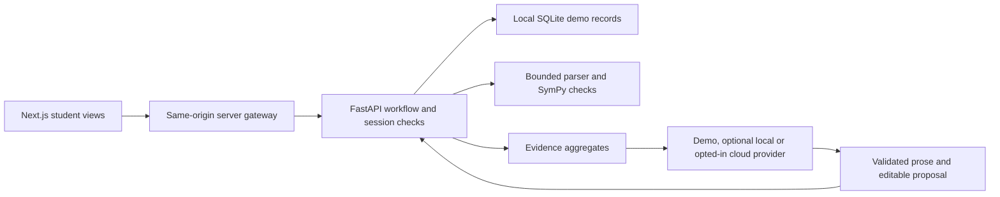

# Student-first architecture

The research package remains intact. The student MVP is a separate bounded educational workflow, with no dependency on MAP files, classifiers or experimental metrics.

## Boundaries

- `frontend/app/page.tsx`: five views with shared saved state; student chooses and edits rather than accepting an automatic diagnosis. React escapes student text; no raw HTML is rendered. Tailwind provides responsive layouts, with a local CSS design system and system fonts (no remote font calls).
- `frontend/app/api/[...path]/route.ts`: allowlisted same-origin adapter. It checks mutation Origin, bounds JSON requests, stores the bearer capability only in HttpOnly cookies and adds the server-only gateway key. Browser clients never choose an upstream URL or receive that key.
- `student/api.py`: validates inputs, session ownership, assessment immutability, workflow prerequisites, limits and persisted transitions. Math results and assignment IDs are server-controlled, not trusted from browser counters. No CORS wildcard or public API docs are exposed.
- `student/math_engine.py`: the original verified 24-problem bank, bounded non-evaluating AST parser and exact checks. The AI provider cannot grade or modify this bank.
- `student/store.py`: SQLite, token hashes, seven-day expiry, atomic mutation transactions and session deletion. Raw synthetic answers/reflections stay in ignored local storage. It closes connections explicitly, including on errors.
- `student/partner.py`: shared local Ollama transport and retained legacy catalogue selector. `student/dialogue.py` assembles minimized multi-turn context, checks equation transformations, generates authored contextual demo replies, validates local-model prose and structured proposals, and handles labeled fallback. Only the current message, four recent turns, relevant checked evidence and a limited plan summary reach the configured local model.
- `student/huggingface.py`: optional pinned Qwen/Nscale routing, shortened two-turn cloud context, strict output schema and persistent atomic application budgets. Missing credentials or account confirmation leaves demo active. Each cloud turn requires fictional-context approval; the adapter makes no billing calls. See [account restrictions and setup](huggingface-ai.md).
- `scripts/dev_mvp.py`: reproducible loopback startup for both runtimes, ephemeral internal secret, isolated browser-test storage and process cleanup.

Framework choices follow the official [Next.js route/cookie APIs](https://nextjs.org/docs/app/api-reference/functions/cookies), [FastAPI testing interface](https://fastapi.tiangolo.com/tutorial/testing/), [Tailwind PostCSS integration](https://tailwindcss.com/docs/installation/using-postcss) and [Ollama structured-output contract](https://docs.ollama.com/capabilities/structured-outputs). Direct runtime dependencies are pinned; the frontend lockfile fixes transitive packages. Python optional extras keep research-only installations lightweight.

## State and access model

One synthetic learner per anonymous browser capability. SQLite stores completed and incomplete assessments, checked results, conversation turns, versioned plan, practice attempt history and reflections. The cookie authenticates possession of a demo capability, not a real school account. The gateway key gates direct backend calls, while per-session capabilities enforce record isolation. API endpoints accept no user-supplied student identifier.

The learner flow is diagnostic → conversation → plan → assigned practice → follow-up → reflection. A plan cannot exist without completed diagnostic evidence and a conversation turn. The follow-up requires every current assigned problem to have an attempt. Attempts, including incorrect ones, are counted separately from checked correctness. Editing a plan preserves attempts; if its target problems change, the new ones must be attempted. If the problem IDs stay the same, prior attempts remain valid. Intended minutes/sessions are not falsely presented as measured time or attendance.

There is one follow-up per session. Plan revisions after reflection are stored, but new assessment/practice cycles are not claimed. The bank deliberately reserves extra questions; robust scheduling and new calibrated forms come later. Non-equivalent entered steps inform targeting independently of final-answer correctness. Missing reasoning never becomes a cause label.

## Tradeoffs and safety limits

The MVP uses a single local SQLite store and serializes mutation transactions, including a bounded provider request. That favors atomic history and avoids double submissions, but a slow local model can delay other writes. This is acceptable for synthetic single-user evaluation; a multi-user system needs reservation/version checks, async work and stronger infrastructure. Limiting successful changes is not a full abuse-resistant public rate limiter. Session creation has a small local capacity cap; no production edge protection is claimed.

Sessions isolate records, but do not provide account recovery, authorization roles, encryption at rest, secure erasure or controls appropriate for minors' real records. Loopback servers, no telemetry in the launcher, ignored local storage and explicit fictional labeling minimize scope rather than claim compliance. Optional cloud inference transmits minimized fictional context only after explicit approval. HTTPS cookies become Secure when served over HTTPS; this does not make deployment approved. The local content-security policy blocks framing and external browser connections but permits Next's inline bootstrap/style requirements; further CSP hardening and independent security review are deployment prerequisites.

Local models can generate bounded tutoring prose and editable structured proposals. Mathematical verdicts remain server-owned. Numerical formulas and selected unsupported claims in prose are rejected, but schema validation cannot establish semantic correctness. Student review and explicit approval are required; proposals cannot automatically become saved plans. A supplied final answer can be checked, but the student's mental process cannot be recovered. The partner asks and records the student's own reflection as a hypothesis. Counts from two problems per topic are descriptive. No probabilistic misconception score, learning-style label or claim of improved grades is shown.

No frontend credentials or `NEXT_PUBLIC` provider secrets exist. The launcher removes HF_TOKEN from the frontend process. Optional hosted inference is limited to explicitly confirmed fictional context; a real-student data policy remains unimplemented. Unit and integration tests do not make an educational effectiveness claim. See [the product specification](student-mvp.md) and [verification report](student-mvp-verification.md).

The contextual extension and current boundaries are detailed in [Strategy Studio architecture](context-aware-studio.md).
